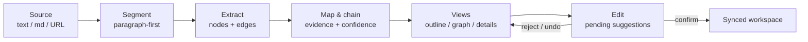

<div align="center">

  <picture>
    <source media="(prefers-color-scheme: dark)" srcset="docs/images/logo-dark.svg">
    
  </picture>

  # Traceify

  **Turn one source into an editable knowledge graph — with bidirectional source mapping, evidence chains, and confidence-aware relationships.**

[简体中文](README.zh-CN.md) | **English**

[](LICENSE)
[](https://github.com/redmaplewww/traceify/actions/workflows/ci.yml)
[](https://github.com/redmaplewww/traceify/stargazers)

[✨ Features](#-features) · [🔍 How It Works](#-how-it-works) · [🚀 Getting Started](#-getting-started) · [🧩 Graph Contract](#-graph-contract) · [🤝 Contributing](#-contributing)

</div>

---

**Traceify** is a skill for AI agents (Codex, and any agent that can load a `SKILL.md`). Feed it one long text, a Markdown file, or a webpage URL, and it produces a structured, editable knowledge graph where every node and edge stays linked to its original source — so you can always click through to the evidence.

## ✨ Features

- 🔗 **Bidirectional source mapping** — every node and edge references the paragraph (or sentence / webpage fragment) it came from, and every excerpt links back to its graph items. Selecting either side reveals the other.
- 🧾 **Evidence chains** — claims are traceable from high-level themes down to the exact source fragments that support them, as ordered, inspectable paths.
- 🎚️ **Confidence-aware relations** — each edge carries a relation label, the basis for that relation, and a 0–1 confidence score. Low-confidence relations stay visible but are visually weaker and flagged for confirmation — nothing unsupported is presented as source fact.
- ✍️ **Editable with a suggestion flow** — when you add nodes or edges, Traceify first creates *pending suggestions* with the supporting fragments and rationale. Accept, edit, reject, or batch-accept them; your edits always win and both AI and user versions are preserved.
- 🧭 **Three linked views** — hierarchical outline, architecture graph, and source/details, kept in sync on every edit. No interactive canvas? It falls back to a Mermaid graph plus stable-ID detail records.
- 🛟 **Failure-safe** — interrupted parsing keeps partial results for retry; sync conflicts keep local and remote values side by side; deleted items retain their evidence so broken chains can be undone or relinked.

## 📥 Supported Inputs

| Input | Mapping granularity |
| --- | --- |
| Pasted text | paragraph → sentence on demand |
| Markdown file | paragraph / heading hierarchy |
| Webpage URL | paragraph / webpage fragment |

One source produces one graph. Multi-source merge is intentionally out of scope for the first version.

## 🔍 How It Works



Segmentation is paragraph-first and only refines to sentences or webpage fragments when a paragraph contains distinct claims (or you ask for finer mapping). Stable IDs (`n-…`, `e-…`, `s-…`) keep every link intact across edits.

## 🚀 Getting Started

### Install as an agent skill

Copy this repository into your agent's skill directory (or point your agent at [`SKILL.md`](SKILL.md)). For Codex, the display metadata in [`agents/openai.yaml`](agents/openai.yaml) is picked up automatically.

### Prompt it

```text
Turn this article into a traceable knowledge graph: https://example.com/long-article
```

```text
Use traceify to map the key relationships in this document and show me
the evidence chain from the main claim back to its sources.
```

```text
Add a node connecting X to Y with an explanation of why.
```

> [!TIP]
> The last prompt lands as a **pending suggestion** — review the proposed node, its source fragments, and relation basis before accepting it into the confirmed graph.

## 📖 Usage Notes

- **One source, one graph.** Don't merge sources unless you explicitly extend the scope.
- **Nothing unsupported is presented as fact.** Every relation shows its evidence basis; inferred links are marked `ai_suggestion` until you confirm them.
- **Edits are versioned.** Editing an AI-extracted item keeps both versions; the user version becomes current.
- **Deletion is safe.** Deleted items keep their source evidence, and affected evidence chains are marked broken so you can undo or relink them.

## 🧩 Graph Contract

All output — whether JSON, Markdown, Mermaid, or an interactive canvas — follows the stable contract in [`references/graph-contract.md`](references/graph-contract.md):

| Field | Contents |
| --- | --- |
| `source` | id, kind, title, locator, content hash, status |
| `graph.nodes` | label, kind, summary, provenance, confidence, source refs, versions |
| `graph.edges` | from/to, relation, relation basis, confidence, provenance |
| `mappings` | reverse index: source excerpt → graph items |
| `outline` | hierarchy items pointing at node IDs |
| `evidence_chains` | ordered node/edge paths ending in source references |
| `pending_suggestions` | proposed adds/updates/relinks, never mixed into the confirmed graph |
| `sync` | state, last sync time, retry count, conflicts |

## 🧪 Testing

```bash
python tests/run_smoke.py
```

The smoke suite fetches each live source in [`tests/source-manifest.json`](tests/source-manifest.json) (a long article, a short post, a paper page, and a documentation site), checks that source acquisition works per case, and prints a JSON report. It needs network access, so it runs locally rather than in CI — CI validates sources and the manifest instead (see [`.github/workflows/ci.yml`](.github/workflows/ci.yml)).

## 📁 Repository Layout

```
traceify/
├── SKILL.md                      # core workflow and scope — what agents load
├── references/
│   └── graph-contract.md         # stable JSON/Markdown/Mermaid data contract
├── agents/
│   └── openai.yaml               # Codex display metadata
├── tests/
│   ├── run_smoke.py              # network smoke suite (run locally)
│   ├── source-manifest.json      # smoke-test sources and checks
│   └── TEST_REPORT.md            # latest recorded run
└── docs/images/                  # logo (light + dark)
```

## 🤝 Contributing

Issues and PRs are welcome! Bug reports are most useful with the source that failed and the graph (or excerpt) that looked wrong. Please keep the scope boundary in [`SKILL.md`](SKILL.md) in mind: one source per graph, adaptive relation labels, no export pipelines in v1.

## 📄 License

[MIT](LICENSE) © 2026 redmaplewww
