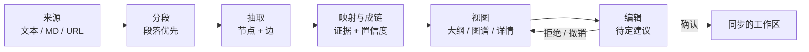

<div align="center">

  <picture>
    <source media="(prefers-color-scheme: dark)" srcset="docs/images/logo-dark.svg">
    
  </picture>

  # Traceify

  **把单一来源变成可编辑的知识图谱——双向溯源映射、证据链、置信度感知的关系标注。**

**简体中文** | [English](README.md)

[](LICENSE)
[](https://github.com/redmaplewww/traceify/actions/workflows/ci.yml)
[](https://github.com/redmaplewww/traceify/stargazers)

[✨ 特性](#-特性) · [🔍 工作原理](#-工作原理) · [🚀 快速开始](#-快速开始) · [🧩 图谱契约](#-图谱契约) · [🤝 贡献](#-贡献)

</div>

---

**Traceify** 是一个面向 AI Agent 的 skill（适用于 Codex 及任何能加载 `SKILL.md` 的 Agent）。给它一段长文本、一个 Markdown 文件或一个网页 URL，它会产出一个结构化、可编辑的知识图谱——每个节点和每条边都与原始来源保持链接，随时可以点击跳转到证据原文。

## ✨ 特性

- 🔗 **双向来源映射**——每个节点和每条边都引用它来自的段落（或句子 / 网页片段），每个原文摘录也能反查关联的图谱项。选中任意一侧，另一侧同步显现。
- 🧾 **证据链**——论断可以从高层主题一路追溯到支撑它的确切原文片段，形成有序、可检查的路径。
- 🎚️ **置信度感知的关系**——每条边都带关系标签、关系依据和 0–1 置信度分。低置信度关系保持可见但视觉上更弱，并标记待确认——绝不把无依据的推断当成原文事实。
- ✍️ **可编辑 + 建议流**——当你添加节点或边时，Traceify 会先创建带支撑片段和理由的**待定建议**。你可以接受、编辑、拒绝或按节点批量接受；你的编辑永远优先，AI 版本与用户版本都会保留。
- 🧭 **三个联动视图**——层级大纲、架构图谱、来源/详情，每次编辑后保持同步。宿主不支持交互画布时，自动降级为 Mermaid 图 + 稳定 ID 详情记录。
- 🛟 **失败安全**——解析中断会保留部分结果供重试；同步冲突把本地值与远程值并排展示；删除的条目保留其证据，断裂的证据链可撤销或重新链接。

## 📥 支持的输入

| 输入类型 | 映射粒度 |
| --- | --- |
| 粘贴文本 | 段落 → 按需细化到句子 |
| Markdown 文件 | 段落 / 标题层级 |
| 网页 URL | 段落 / 网页片段 |

一个来源生成一张图谱。多源合并刻意不在第一版范围内。

## 🔍 工作原理



分段以段落优先，只有当一段包含多个独立论断（或你要求更细粒度）时才细化到句子或网页片段。稳定 ID（`n-…`、`e-…`、`s-…`）保证链接在编辑过程中不断裂。

## 🚀 快速开始

### 安装为 Agent Skill

把本仓库复制进你的 Agent skill 目录（或让 Agent 直接读取 [`SKILL.md`](SKILL.md)）。Codex 会自动识别 [`agents/openai.yaml`](agents/openai.yaml) 中的展示元数据。

### 用提示词调用

```text
把这篇文章转成可溯源的知识图谱：https://example.com/long-article
```

```text
用 traceify 梳理这份文档里的关键关系，并展示从核心论断
回溯到原文的证据链。
```

```text
添加一个节点，把 X 和 Y 连起来，并解释为什么。
```

> [!TIP]
> 最后这条提示词会生成一个**待定建议**——先审查提议的节点、它的来源片段和关系依据，再决定是否并入已确认图谱。

## 📖 使用须知

- **一个来源，一张图谱。** 除非你明确扩展范围，否则不合并多个来源。
- **无依据不呈现为事实。** 每条关系都展示证据依据；推断出的链接会标记为 `ai_suggestion`，直到你确认。
- **编辑有版本。** 编辑 AI 抽取的条目时保留两个版本，用户版本成为当前版本。
- **删除是安全的。** 被删除的条目保留来源证据，受影响的证据链标记为断裂，可撤销或重新链接。

## 🧩 图谱契约

所有输出——无论 JSON、Markdown、Mermaid 还是交互画布——都遵循 [`references/graph-contract.md`](references/graph-contract.md) 中的稳定契约：

| 字段 | 内容 |
| --- | --- |
| `source` | id、类型、标题、定位符、内容哈希、状态 |
| `graph.nodes` | 标签、类型、摘要、来源属性、置信度、来源引用、版本 |
| `graph.edges` | 起点/终点、关系、关系依据、置信度、来源属性 |
| `mappings` | 反向索引：原文摘录 → 图谱项 |
| `outline` | 指向节点 ID 的层级条目 |
| `evidence_chains` | 以来源引用结尾的有序节点/边路径 |
| `pending_suggestions` | 待定的增/改/重连建议，绝不混入已确认图谱 |
| `sync` | 同步状态、上次同步时间、重试次数、冲突列表 |

## 🧪 测试

```bash
python tests/run_smoke.py
```

冒烟套件会抓取 [`tests/source-manifest.json`](tests/source-manifest.json) 中的每个真实来源（一篇长文、一条短帖、一个论文页、一个文档站），逐例检查来源获取是否正常，并输出 JSON 报告。它需要网络访问，因此在本地运行而非 CI 中——CI 只校验来源与清单本身（见 [`.github/workflows/ci.yml`](.github/workflows/ci.yml)）。

## 📁 仓库结构

```
traceify/
├── SKILL.md                      # 核心工作流与范围——Agent 加载的入口
├── references/
│   └── graph-contract.md         # 稳定的 JSON/Markdown/Mermaid 数据契约
├── agents/
│   └── openai.yaml               # Codex 展示元数据
├── tests/
│   ├── run_smoke.py              # 网络冒烟套件（本地运行）
│   ├── source-manifest.json      # 冒烟测试来源与检查项
│   └── TEST_REPORT.md            # 最近一次运行记录
└── docs/images/                  # logo（亮色 + 暗色）
```

## 🤝 贡献

欢迎 Issue 和 PR！Bug 报告最好附上失败的来源 URL 和出错的图谱（或摘录）。提交前请留意 [`SKILL.md`](SKILL.md) 中的范围边界：一个来源一张图谱、关系标签自适应、第一版不做导出管线。

## 📄 License

[MIT](LICENSE) © 2026 redmaplewww
